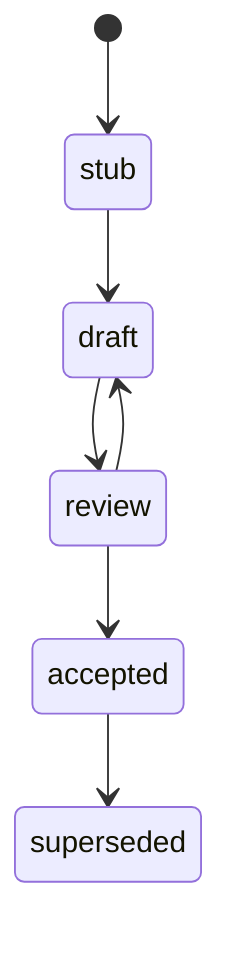

# Chapter format

## Structure

`design/` contains parts. A part is a folder. A part contains chapters. A chapter is one Markdown file. A chapter contains sections. A section is a level-2 heading and its content.

```text
design/
  index.md                    front page: title, introduction, chapters in reading order
  index.typ                   builds one PDF of the design from index.md
  questions.md                open questions
  <part-name>/
    <chapter-name>.md
  styles/<style-id>.md        style cards
  decisions/adr-NNNN-<slug>.md
```

Part and chapter names are lowercase words joined by hyphens. They do not contain position numbers. The order of the parts and chapters is the order in `index.md`. The number in an ADR file name is the ID of the decision, not a position.

Projects that use maid use the same structure.

A chapter covers one area of the project. A chapter can be 1 to 20 pages. An agent normally reads sections, not whole chapters.

## Requirements

### REQ-DOC-001 Chapter location
The design store shall contain each chapter as exactly one Markdown file in exactly one part folder.

### REQ-DOC-002 Frontmatter
Each chapter shall start with YAML frontmatter that contains the fields `id`, `title`, `part`, `status`, `style`, `owner`, `summary` and `links`.

### REQ-DOC-003 Summary length
The `summary` field shall contain at most 60 words.

### REQ-DOC-004 Declared style
Each chapter shall declare exactly one style in the `style` field, and the value shall match a style ID in the style registry.

### REQ-DOC-005 Embedded styles
Where a chapter contains a fenced code block with a language tag that is a registered style ID, maid shall validate that block against that style instead of the chapter style.

### REQ-DOC-006 Stable IDs
Each requirement, decision, work item and open question shall have an ID that is unique in the project and that never changes.

### REQ-DOC-007 No ID reuse
If an item is removed, then maid shall keep its ID reserved and shall not assign the ID to another item.

### REQ-DOC-008 Addressable sections
The design store shall make each level-2 and level-3 heading addressable as `<chapter-id>#<anchor>`, where the anchor is the item ID when the heading starts with an ID.

### REQ-DOC-009 Status values
The `status` field of a chapter or an item shall have one of these values: `stub`, `draft`, `review`, `accepted`, `superseded`.

### REQ-DOC-010 Write rule for open items
While a chapter or an item has status `stub` or `draft`, maid shall accept a direct write to it from any agent.

### REQ-DOC-011 Write rule for accepted items
While a chapter or an item has status `accepted`, maid shall reject a direct write to it and shall accept a proposal instead.

### REQ-DOC-012 Version check
When maid receives a write to a section, maid shall reject the write if the section changed after the version that the writer read.

### REQ-DOC-013 Unknown information
If a writer does not have the information for a required section, then the writer shall write `TBD (Q-NNN)` and shall add question `Q-NNN` to `questions.md`.

### REQ-DOC-014 Generated index
When a chapter changes, maid shall regenerate `design/index.md` from the frontmatter of all chapters.

### REQ-DOC-015 Links
Each ID in the `links` field shall resolve to an existing chapter, item or decision.

## Frontmatter reference

| Field | Type | Meaning |
|---|---|---|
| `id` | string | Chapter ID. Lowercase, hyphenated. Unique. |
| `title` | string | Human title. |
| `part` | string | The part folder name. |
| `status` | enum | See REQ-DOC-009. |
| `style` | string | Style ID from the style registry. |
| `owner` | string | The person who accepts changes. |
| `summary` | string | At most 60 words. What the chapter covers and who needs it. |
| `links` | list | IDs of related chapters, items and decisions. |

## ID prefixes

| Prefix | Item |
|---|---|
| `REQ-<AREA>-NNN` | Requirement. AREA is a short code for the chapter. |
| `ADR-NNNN` | Decision record. |
| `WI-...` | Work item. The task store assigns the suffix. |
| `Q-NNN` | Open question. |
| `G-NNN` | Goal. |
| `NG-NNN` | Non-goal. |

## Status lifecycle



A human or a configured review agent moves an item from `review` to `accepted`.
