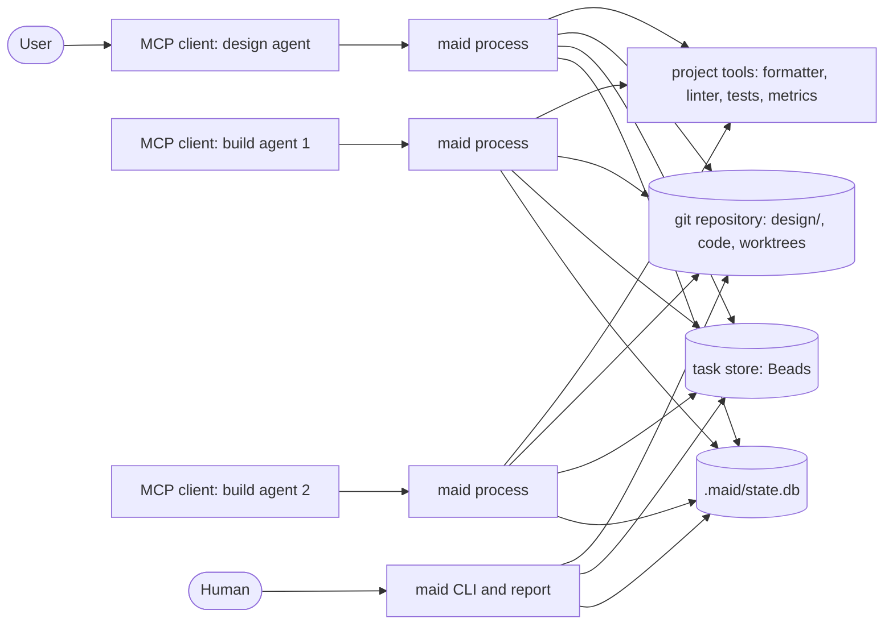

# Architecture overview

## Context

Each MCP client starts its own maid process over stdio. A client can also connect to one shared `maid serve` process over streamable HTTP. Both modes use the same shared state.

## Components

| Component | Responsibility |
|---|---|
| MCP server | Exposes tools, resources and prompts. Adds the next-step hint to each response. |
| CLI | Gives humans the same operations and reports as the MCP server. |
| Guide | Derives the current phase. Evaluates gates. Builds the `maid_next` response. |
| Design store | Parses `design/`. Resolves IDs and sections. Applies write rules and version checks. Regenerates the index. |
| Validator runner | Runs style validators on chapters and code blocks. |
| Task port | Interface to the task store. The v1 adapter is Beads. See `task-store`. |
| Workspace manager | Creates and removes git worktrees and branches for attempts. |
| Context packer | Builds the context packet for a claimed work item. |
| Merge queue | Rebases, checks, tests and merges submissions. See `acceptance`. |
| Tool runner | Runs the formatter, linter, test runner and metrics adapters that the decisions select. Parses their results into common formats. |
| Scorer | Calculates the score from the tool runner results. |
| State store | SQLite database in `.maid/state.db`. Holds attempts, test baselines, scores, queue entries, locks and the activity log. |
| Reporter | Builds `maid status` output and the HTML report. |

## Process model

- Many maid processes can run in one project at the same time.
- All shared state is in the state store, the task store or git. No process keeps shared state in memory.
- The state store uses SQLite in WAL mode. Each write is a transaction.
- One process at a time runs the merge queue. The process holds a lock row with a lease in the state store. If the lease expires, another process takes the lock.

## State locations

| State | Location | In git |
|---|---|---|
| Specification | `design/` | yes |
| Generated documentation | `docs/` | yes |
| Work items, claims, leases | task store (`.beads/`) | Beads syncs through its own git refs |
| Attempts, scores, baselines, queue, log | `.maid/state.db` | no |
| Worktrees | `.maid/worktrees/` | no |

## Open issues

- Process model for `maid serve` with remote agents: TBD (Q-003).
- Whether the state store and the task store merge into one store later: TBD (Q-008).
