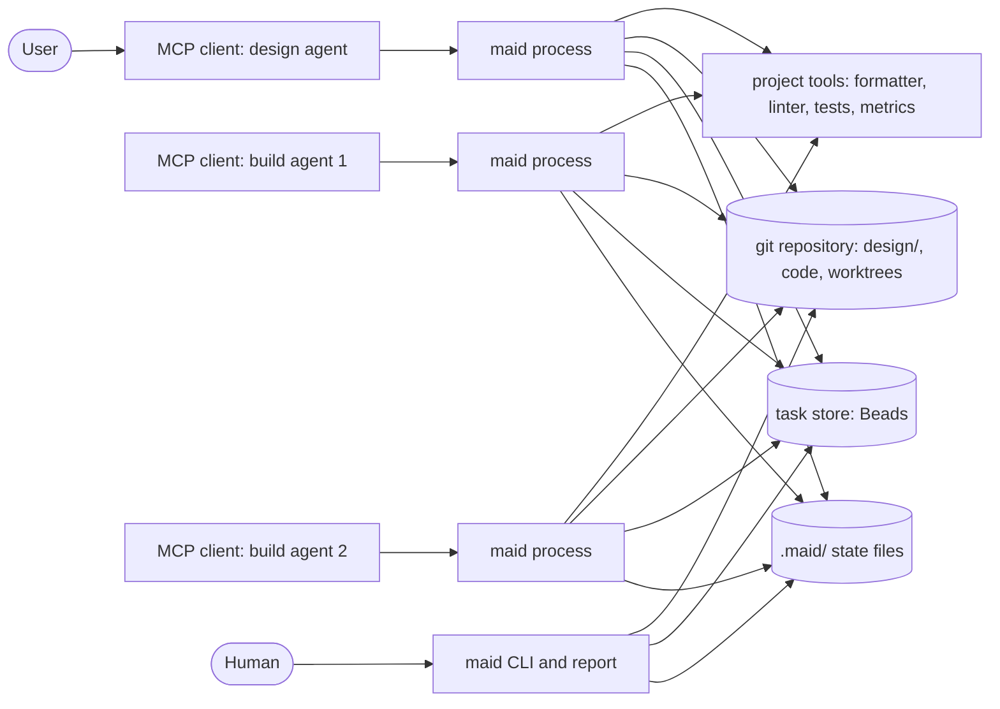

# Architecture overview

## Context

Each MCP client starts its own maid process over stdio. A client can also connect to one shared `maid serve` process over streamable HTTP. Both modes use the same shared state.

## Components

| Component | Responsibility |
|---|---|
| MCP server | Exposes tools, resources and prompts. Adds the next-step hint to each response. |
| CLI | Gives humans the same operations and reports as the MCP server. |
| Guide | Derives the current phase. Evaluates gates. Builds the `maid_next` response. |
| Design store | Parses `design/`. Resolves IDs and sections. Applies write rules and version checks. Regenerates the index. |
| Validator runner | Runs style validators on chapters and code blocks. |
| Task port | Interface to the task store. The v1 adapter is Beads. See `task-store`. |
| Workspace manager | Creates and removes git worktrees and branches for attempts. |
| Context packer | Builds the context packet for a claimed work item. |
| Merge queue | Rebases, checks, tests and merges submissions. See `acceptance`. |
| Tool runner | Runs the formatter, linter, test runner and metrics adapters that the decisions select. Parses their results into common formats. |
| Scorer | Calculates the score from the tool runner results. |
| State store | JSON files in `.maid/` with file locks (ADR-0007). Holds attempts, test baselines, the queue lock and the activity log. A SQLite adapter can replace it. |
| Reporter | Builds `maid status` output and the HTML report. |

## Process model

- Many maid processes can run in one project at the same time.
- All shared state is in the state store, the task store or git. No process keeps shared state in memory.
- The state store writes each file atomically through a temporary file.
- One process at a time runs the merge queue. The process holds an exclusive file lock. The operating system releases the lock if the process stops.

## State locations

| State | Location | In git |
|---|---|---|
| Specification, with current and target state | `design/` | yes |
| Generated documentation | `docs/` | yes, where a generator is configured |
| Work items, claims, leases | Beads database in `.beads/` | synced with `bd dolt push`; exported to `.beads/issues.jsonl` and committed |
| Attempts, scores, baselines, queue, log | `.maid/*.json`, `.maid/activity.jsonl` | no |
| Worktrees | `.maid/worktrees/` | no |

## Scope decisions

- In v1, `maid serve` accepts connections only from the same machine. Agents on other machines are out of scope for v1 (Q-003).
- The state store and the task store stay separate, so that the task port can use another adapter (Q-008).
