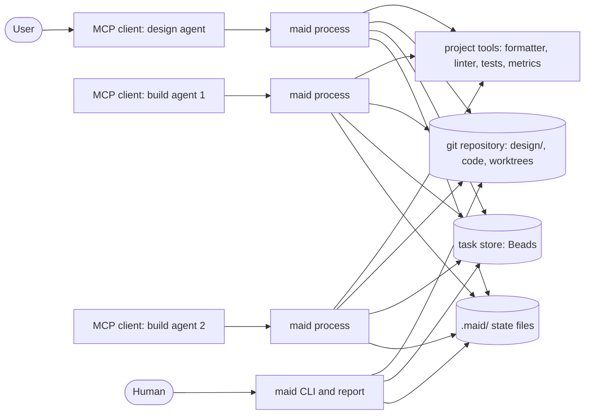

# Architecture and task store

## Context

Each MCP client starts its own maid process over stdio. A client can also connect to one shared `maid serve` process over streamable HTTP. Both modes use the same shared state.

## Components

| Component | Responsibility |
|---|---|
| MCP server | Exposes tools, resources and prompts. Adds the next-step hint to each response. |
| CLI | Gives humans the same operations and reports as the MCP server. |
| Guide | Derives the current phase. Evaluates gates. Builds the `maid_next` response. |
| Design store | Parses `design/`. Resolves section paths. Applies write rules and version checks. Regenerates the index. |
| Validator runner | Runs style validators on chapters and code blocks. |
| Task port | Interface to the task store. The v1 adapter is Beads. See the task store port below. |
| Workspace manager | Creates and removes git worktrees and branches for attempts. |
| Context packer | Builds the context packet for a claimed work item. |
| Merge queue | Rebases, checks, tests and merges submissions. See the acceptance chapter. |
| Tool runner | Runs the formatter, linter, test runner and metrics adapters that the decisions select. Parses their results into common formats. |
| Scorer | Calculates the score from the tool runner results. |
| State store | JSON files in `.maid/` with file locks. Holds attempts, test baselines, the queue lock and the activity log. A SQLite adapter can replace it. |
| Reporter | Builds `maid status` output and the HTML report. |

## Process model

- Many maid processes can run in one project at the same time.
- All shared state is in the state store, the task store or git. No process keeps shared state in memory.
- The state store writes each file atomically through a temporary file.
- One process at a time runs the merge queue. The process holds an exclusive file lock. The operating system releases the lock if the process stops.

## Project assets

maid installs a small set of files in a new project. `design/index.typ` builds the book. `scripts/compile-pdf.sh` builds a light PDF and a dark PDF. `.github/workflows/release-design-pdf.yml` attaches the dark PDF to a major or minor release. `.gitattributes` marks PDFs as generated. maid does not overwrite these files when they already exist.

## State locations

| State | Location | In git |
|---|---|---|
| Specification, with current and target state | `design/` | yes |
| Generated documentation | `docs/` | yes, where a generator is configured |
| Work items, claims, leases | Beads database in `.beads/` | synced with `bd dolt push`; exported to `.beads/issues.jsonl` and committed |
| Attempts, scores, baselines, queue, log | `.maid/*.json`, `.maid/activity.jsonl` | no |
| Worktrees | `.maid/worktrees/` | no |

## Scope decisions

- In v1, `maid serve` accepts connections only from the same machine. Agents on other machines are out of scope for v1.
- The state store and the task store stay separate, so that the task port can use another adapter.

## Task store port

The task port is a Go interface. maid code uses only the port. The adapter is replaceable.

| Operation | Meaning |
|---|---|
| `Create(items, deps)` | Create work items and their dependencies in one operation. |
| `Ready(filter)` | List work items that have no open blocker. |
| `Claim(id, agent, ttl)` | Claim one work item atomically. Return a conflict if another agent holds it. |
| `ClaimNext(filter, agent, ttl)` | Claim the first ready work item that matches the filter, atomically. |
| `Heartbeat(id, agent)` | Renew the lease. |
| `Reclaim(olderThan)` | Return work items with expired leases to ready. |
| `Release(id, agent)` | Give up a claim. |
| `Close(id, reason)` | Close a work item. Dependents become ready. |
| `Get(id)` / `List(filter)` | Read work items. |

maid-specific fields (`implements`, `acceptance_tests`, `owns`, `reads`, `budget`, `kind`) are stored in a namespaced metadata object, `maid.*`.

The `implements` field holds section paths in the design, such as `acceptance#merge-queue-acceptance`. It names the requirement by what it says, not by an assigned code.

## Beads adapter

The adapter calls the `bd` CLI with `--json` and parses the result. It does not link Beads as a Go library. See the Beads decision.

| Port operation | Beads command |
|---|---|
| `Create` | `bd create --graph <plan.json>` or `bd create … --deps … --metadata …` |
| `Ready` | `bd ready --json` |
| `Claim` | `bd update <id> --claim --json` |
| `ClaimNext` | `bd ready --claim --json` |
| `Heartbeat` | `bd heartbeat <id>` |
| `Reclaim` | `bd reclaim` |
| `Release` | `bd unclaim <id>` |
| `Close` | `bd close <id> --reason …` |
| `Get` | `bd show <id> --json` |

Native Beads fields that maid uses: `spec_id` (first linked requirement section), `acceptance_criteria`, `metadata`, `assignee`, dependencies.

### Initialisation and sharing

maid runs `bd init --non-interactive --skip-agents --skip-hooks --quiet`. `--skip-agents` is required because `bd init` otherwise writes `AGENTS.md` and `CLAUDE.md`, and maid owns those files.

Tasks are part of the project and are shared in two ways:

- Beads syncs its database through the project's git remote with `bd dolt push` and `bd dolt pull`. Any clone with `bd` sees the same tasks.
- maid writes `.beads/issues.jsonl` with `bd export` after each change to the tasks, and commits it. Humans and agents without `bd` can read the tasks in git.

### Tasks in git

When maid creates, claims, closes or changes a work item, maid shall export the tasks to `.beads/issues.jsonl` and commit the file.

## Spike findings

Date: 2026-11-27. bd version 1.3.4, embedded Dolt mode. Reproduce with `spikes/beads/run.sh`.

| Test | Result |
|---|---|
| Create work items with dependencies, spec ID, acceptance text and custom metadata | Pass. All fields round-trip through `bd show --json`. |
| `bd ready` with a dependency graph | Pass. Only items without open blockers are listed. |
| Close an item | Pass. Its dependents become ready. |
| Six processes claim the same item at the same time | Pass. Exactly one claim succeeds. Five receive a conflict with exit code 1. |
| Twenty processes claim twenty different items at the same time | Pass. All succeed. Writes are serialised at about 0.45 seconds each. |
| Eight processes run `bd ready --claim` on a pool of eight items | Pass. Each process gets a different item. |
| Concurrent readers during claims | Pass. No errors. |
| Leases | Present: `heartbeat`, `reclaim`, lease TTL. |

## Concerns

| Concern | Effect | Mitigation |
|---|---|---|
| Write latency about 0.45 seconds, serialised | Acceptable for tens of agents. Not for hundreds. | Measure again with server mode if needed. |
| The `bd` binary is about 150 MB | Larger install. | Install `bd` separately. maid checks for it and reports the install command. |
| The Go library needs cgo for embedded Dolt, and the module requires a newer Go than maid may use | Linking breaks the single static binary. | Use the CLI. |
| `bd close` refuses when the actor is not the assignee | The merge queue cannot close an item as itself. | The adapter sets `BEADS_ACTOR` to the claim owner when it closes an item. |
| Beads changes quickly | The CLI contract can change. | Pin a minimum `bd` version. Run adapter contract tests in CI. |

## Proposal: Align architecture with stdio-only implementation

status: proposed · by opencode-978a9f · 2026-11-28

### stdio in milestone 1
The MCP server shall use stdio and tools in milestone 1.

### HTTP target
Where streamable HTTP is added, the MCP server shall accept only loopback connections.

### Current scorer component
The scorer shall calculate scores in `internal/score`. Merge queue use of the score shall be a target.

### Current reporter component
The reporter shall build `maid status`. The HTML report shall be a target.

### Current task store
The task store shall use Beads through its CLI. Export to `.beads/issues.jsonl` and commit shall be a target.
