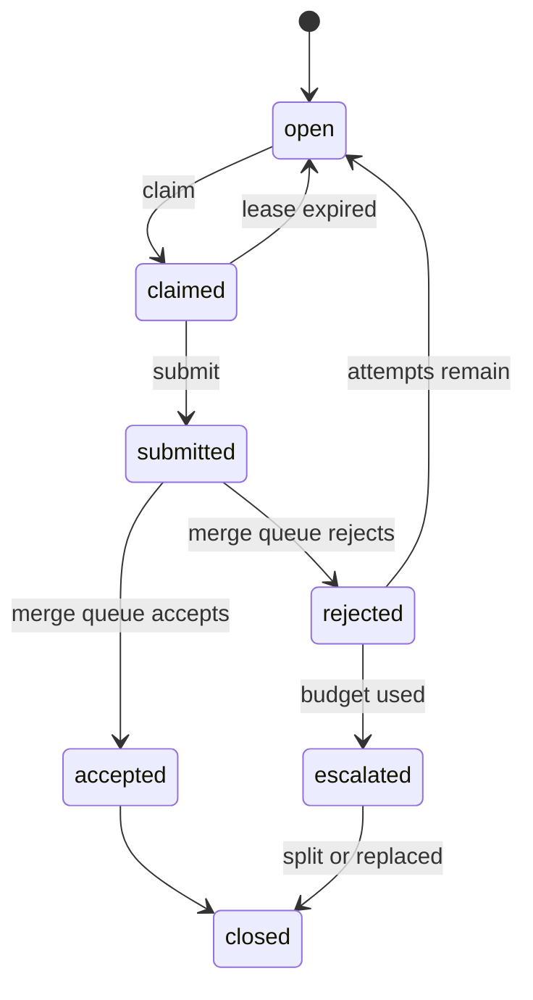

# Work items, claims and context packets

## Work item fields

| Field | Required | Meaning |
|---|---|---|
| `id` | yes | Assigned by the task store. |
| `title` | yes | One line. |
| `implements` | yes | Section paths in the design, such as `acceptance#atomic-claim`. |
| `acceptance_tests` | yes | Test IDs or test paths. Written before any attempt. |
| `owns` | yes | File path patterns that this work item can change. |
| `reads` | no | File path patterns that the agent can read but not change. |
| `depends_on` | no | Work item IDs. |
| `budget` | yes | Maximum attempts and maximum changed lines. From the profile. |
| `kind` | yes | `code`, `tests` or `docs`. |
| `criteria` | for `code` | Gherkin scenarios written by the design agent. |
| `tests_for` | for `tests` | The `code` work item whose acceptance tests this item writes. |
| `status` | yes | `open`, `claimed`, `submitted`, `accepted`, `rejected`, `escalated`, `closed`. |

## Requirements

### Size
The design agent shall create work items that a build agent can complete in one session, with a changed-line budget from the profile.

### Acceptance tests first
The task store shall not offer a work item as ready until its acceptance tests exist on the main branch and fail.

### Ready work
When an agent asks for work, maid shall offer only work items that have no open dependency and no owned path in common with a claimed work item.

### Atomic claim
When two agents claim the same work item at the same time, maid shall give the claim to exactly one agent and shall return a conflict to the other agent.

### Lease
While an agent holds a claim, the agent shall renew the lease before it expires.

### Expired lease
If a lease expires, then maid shall return the work item to ready and shall record the attempt as abandoned.

### Isolated workspace
When an agent claims a work item, maid shall create a detached git worktree at the current commit of the maid branch for that attempt, and shall not create a branch for the attempt.

### Owned paths
If a submission changes a file outside the `owns` patterns of the work item, then the merge queue shall reject the submission.

### Escalation
If a work item has the number of rejected attempts that its budget allows, then maid shall set the work item to `escalated` and shall offer it to a design agent.

### Escalation result
When a design agent takes an escalated work item, the design agent shall split the work item, clarify the linked items, or correct the acceptance tests.

### Parallel attempts
Where the profile enables parallel attempts, maid shall allow up to N attempts on the same work item at the same time, and the merge queue shall accept only the attempt with the highest score.

### Docs work items
Where a work item has kind `docs`, its acceptance tests shall be the style validator, the required sections and the link check of the target chapter.

### Cost record
When an agent submits an attempt, maid shall record the attempt count, the elapsed time and any cost that the agent reports, and maid shall limit work items by attempts only.

### Test work item
When the design agent creates a work item of kind `code`, maid shall create a work item of kind `tests` that writes its acceptance tests from its acceptance criteria.

### Order
The task store shall make each `code` work item depend on its `tests` work item.

### Independence
If an agent held the claim on a `tests` work item, then maid shall not give that agent a claim on the `code` work item that it tests.

### Tests acceptance
Where a work item has kind `tests`, its acceptance checks shall be: the tests compile, each test fails on the main branch, and each acceptance criterion is covered by at least one test that carries the criterion tag.

### Review of tests
Where the depth level is rigorous, the merge queue shall hold each accepted `tests` submission for review by the design agent or a human.

## Requirements: context packet

### Packet contents
When an agent claims a work item, maid shall return a context packet that contains:

- the work item fields,
- the text of each linked requirement and its section,
- the contracts that the owned code implements or calls,
- the acceptance test files,
- the list of owned and readable paths,
- the style cards and conventions that apply,
- the commands to format, lint and test.

### Packet size
The context packet shall not include whole chapters when a section is enough, and maid shall report the size of the packet in tokens.

### No browsing needed
The context packet shall contain enough information for a build agent to complete the work item without reading other parts of the design.

## Lifecycle

## Requirements: test stubs

In compiled languages, a test that calls code that does not exist does not compile. A stub makes the tests compile and fail. A stub cannot implement the behaviour, because the merge queue rejects tests that pass on the main branch.

### Stubs
Where the code that the acceptance tests call does not exist on the main branch, the test agent shall add stubs with the names and signatures from the criteria, with bodies that return zero values.

### Tests item ownership
When maid creates a tests work item, maid shall give it ownership of its test files and of the owned files of its code item.

## Requirements: work through maid only

An agent can complete a work item with maid's tools alone. It does not need file or shell access on the machine that runs maid.

### Read worktree files
When an agent that holds the claim on a work item asks for a file in its worktree, maid shall return the file content.

### Write owned files
When an agent that holds the claim on a work item writes a file, maid shall write the file in the agent's worktree only if the work item owns the path.

### Run checks
When an agent that holds the claim on a work item asks to run the tests, the format check or the lint, maid shall run the configured command in the agent's worktree and return the result.

### Commit
When an agent that holds the claim on a work item asks to commit, maid shall commit every change in the agent's worktree on its attempt branch.

### Submit a patch
When an agent submits a work item with a patch or a set of files, maid shall apply them in the agent's worktree, commit them and run the merge queue, and shall refuse a patch that changes a path that the work item does not own.

### Referenced sections
When the criteria of a work item name a design chapter or section, maid shall include the text of each named section in the context packet.

### Minimal edits
When an agent that holds the claim on a work item sends a list of text replacements for an owned file, maid shall replace each old text with its new text and write the file.

### Edit match rule
If the old text of a replacement occurs zero times or more than once in the file, then maid shall refuse the whole edit, keep the file unchanged and return the number of matches.

### Tolerant patches
When an agent submits a unified diff, maid shall recount the line numbers of each hunk and ignore whitespace differences in context lines before it applies the patch.

### Minimal changes first
maid shall tell agents to change existing files with work_edit or a patch, and to use work_write only for new files and full rewrites.
