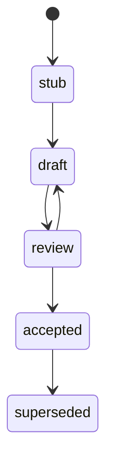

# Design format and styles

## Structure

`design/` contains parts. A part is a folder. A part contains chapters. A chapter is one Markdown file. A chapter contains sections. A section is a level-2 or level-3 heading and its content.

```text
design/
  index.md                  design title and the files in reading order
  index.typ                 builds one PDF of the design from index.md
  foundation/
    <chapter-name>.md
  specification/
    <chapter-name>.md
  method/
    <chapter-name>.md
  implementation/
    <chapter-name>.md
  decisions/
    <decision-name>.md
```

Part and chapter names are lowercase words joined by hyphens. They do not contain position numbers. The order of the parts and chapters is the order in `index.md`.

`index.md` holds only information that no other file holds: the design title and the reading order. It has no frontmatter. Statuses, styles, owners, summaries and links stay in the frontmatter of each file. Chapter names come from file names and titles from level-1 headings. The part comes from the folder name.

Projects that use maid use the same structure.

A chapter covers one area of the project. A chapter can be 1 to 20 pages. An agent normally reads sections, not whole chapters.

## Requirements

### Chapter location
The design store shall contain each chapter as exactly one Markdown file at `design/<part>/<chapter>.md`, where the part and chapter names are lowercase, hyphenated and do not start with a digit.

### Frontmatter
Each chapter shall start with YAML frontmatter that contains the fields `status`, `style`, `owner`, `summary` and `links`.

### Chapter identity
The name of a chapter shall come from its file name, and its title shall come from its level-1 heading.

### Part identity
The part of a chapter shall come from the name of its folder.

### Summary length
The `summary` field shall contain at most 60 words.

### Declared style
Each chapter shall declare exactly one style in the `style` field, and the value shall match a style in the style registry.

### Embedded styles
Where a chapter contains a fenced code block with a language tag that is a registered style, maid shall validate that block against that style instead of the chapter style.

### Addressable sections
The design store shall make each level-2 and level-3 heading addressable as `<chapter>#<heading slug>`.

### Status values
The `status` field of a chapter shall have one of these values: `stub`, `draft`, `review`, `accepted`, `superseded`.

### Write rule for open items
While a chapter has status `stub` or `draft`, maid shall accept a direct write to it from any agent.

### Write rule for accepted items
While a chapter has status `accepted`, maid shall reject a direct write to it and shall accept a proposal instead.

### Version check
When maid receives a write to a section, maid shall reject the write if the section changed after the version that the writer read.

### Unknown information
If a writer does not have the information for a required section, then the writer shall ask the user.

### Record the answer
When the answer arrives, the writer shall record it in that section. maid shall not create a separate register of questions.

### Reading order
The file `design/index.md` shall contain only the design title as a level-1 heading and a bulleted list of file paths, relative to `design/`, in reading order.

### Links
Each entry in the `links` field shall resolve to an existing chapter or section.

### Complete index
maid shall report an error for each chapter in a part folder that `design/index.md` does not list, and for each entry in `design/index.md` whose file does not exist.

### New chapters in the index
When an agent creates a chapter, maid shall add the path of the chapter to `design/index.md` after the last path in the same part folder, or at the end of the list when no path is in that folder.

### PDF build
The file `design/index.typ` shall build the design as one PDF with Typst: it shall read the title and the reading order from `design/index.md`, start a part at each new part folder, number the parts with roman numerals and nothing else, include each file with the cmarker package, use a sans-serif font, and start with a title page that shows the title at the bottom left.

### Page breadcrumb
Each page of the PDF shall show a footer breadcrumb in the form `<design title> · <part name> · <chapter title>`.

### Breadcrumb sources
The breadcrumb shall take the design title from `design/index.md`, the part name from the folder of the current chapter, and the chapter title from its level-1 heading.

### Installed template
maid shall create the same breadcrumb template in every project that it installs.

### Unnumbered headings
The design store shall contain no chapter or section heading that starts with a position number; numbered lists are only for sequences such as steps, tasks and roadmap milestones.

### Index files
When maid creates a chapter, maid shall create `design/index.md` and `design/index.typ` if they do not exist, and shall commit them with the chapter.

### Index is not a chapter
The design store shall not load `design/index.md` as a chapter.

## Frontmatter reference

| Field | Type | Meaning |
|---|---|---|
| `status` | enum | See the status lifecycle below. |
| `style` | string | A style from the style registry. |
| `owner` | string | The person who accepts changes. |
| `summary` | string | At most 60 words. What the chapter covers and who needs it. |
| `links` | list | Names of related chapters and sections. |

## Status lifecycle



A human or a configured review agent moves an item from `review` to `accepted`.

## Registered styles

| Style | Standard | Use for | Card | Validator | v1 enforcement |
|---|---|---|---|---|---|
| `ste` | ASD-STE100 Simplified Technical English | descriptive prose, procedures | `specification/styles.md#simplified-technical-english` | built-in: sentence length, voice, one instruction per sentence, glossary terms | error |
| `ears` | EARS (Easy Approach to Requirements Syntax) | requirements | `specification/styles.md#ears-requirements` | built-in: pattern match on each requirement | error |
| `sbvr-se` | SBVR Structured English | vocabulary, business rules | `specification/styles.md#sbvr-structured-english` | built-in: keyword and term check | error |
| `gherkin` | Gherkin | acceptance criteria, examples | `specification/styles.md#gherkin` | Gherkin parser | error |
| `ace` | Attempto Controlled English | statements that need logical precision | `specification/styles.md#attempto-controlled-english` | external: APE parser | advice until the adapter exists |

Formalized English is not registered. maid has no validator that it can run for it. ACE stays registered with advice-only enforcement. The APE adapter is planned after v1.

## Requirements: styles

### Registered styles only
maid shall reject a chapter whose `style` value is not a registered style.

### Style card
Each registered style shall have a style card that states the rules, gives correct and incorrect examples, and fits in 1500 tokens.

### Validator contract
Each validator shall take a Markdown file or a code block as input and shall return a list of findings, where each finding has a location, a rule, a severity and a message.

### Enforcement levels
Each registered style shall have an enforcement level of `error` or `advice`, and only findings from styles at level `error` shall fail a gate or a docs work item.

### Card in context packet
When a context packet includes a section, maid shall include the style card of the chapter style and of each embedded style in that section.

### Scope of a validator
A validator shall check only the content that its style governs: the chapter body for the chapter style, and fenced blocks for embedded styles. Frontmatter, tables and code blocks of other languages are excluded.

### New styles
When a user adds a style, maid shall require a style card and an enforcement level, and shall set the enforcement level to `advice` until a validator is configured.

## Validator rules for EARS requirements

An EARS requirement is the first paragraph after a requirement heading. The `<system>` is a named component or `maid`.

| Pattern | Template |
|---|---|
| Ubiquitous | The `<system>` shall `<response>`. |
| Event-driven | When `<trigger>`, the `<system>` shall `<response>`. |
| State-driven | While `<state>`, the `<system>` shall `<response>`. |
| Unwanted behaviour | If `<condition>`, then the `<system>` shall `<response>`. |
| Optional feature | Where `<feature>`, the `<system>` shall `<response>`. |
| Complex | A combination of the keywords above, in the order Where, While, When or If. |
